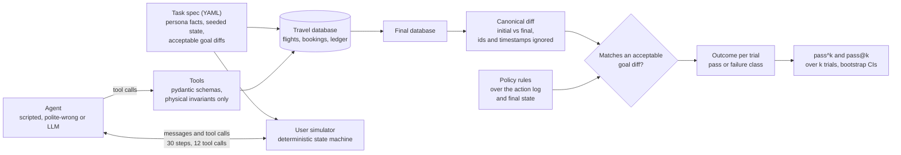

# endstate

[](https://github.com/SlateGitOrg/endstate/actions/workflows/ci.yml)


endstate is a deterministic evaluation harness for a travel-rebooking support agent. It grades an agent by the booking database it leaves behind rather than by what it said, checks every action against declarative fare rules, and reports pass^k reliability over repeated trials with the unbiased combinatorial estimator. The harness is validated against a rule-based agent whose pass^k is known in closed form from its planted failure probabilities, and against a polite agent that scores high on transcript similarity and zero on end state. All data is synthetic and generated from a seed.

## The problem

An online travel agency is piloting an LLM agent that rebooks passengers after cancellations and handles refund requests. Transcript-similarity evals reward a polite agent that issues a cash refund on a non-refundable fare, because the words look right. A single successful run also hides that the same task may succeed only seven times in ten. The team needs a deterministic environment, grading on the final state of the bookings, explicit fare rules and a reliability number.

## How it works



1. `endstate seed` builds the database and 60 tasks. Each task carries persona facts and one or two goal diffs, produced by running a reference action list through the real tools.
2. `endstate run` plays each task several times: the agent talks to the simulated customer and calls tools against a fresh copy of the database. Trajectories are saved as JSONL.
3. `endstate grade` replays each trajectory's tool calls on a fresh database, diffs initial against final state, matches the diff against the acceptable goal diffs and runs the seven fare rules. A trial passes only when a goal diff matches and no rule is violated. Failures are labelled `WRONG_END_STATE`, `POLICY:<rule>`, `STEP_LIMIT`, `BUDGET` or `TOOL_ERROR_UNRECOVERED`.
4. `endstate report` computes pass^k and pass@k per agent, with bootstrap intervals over tasks, the analytic expectation for the scripted agent and the transcript-similarity contrast.

The fare rules are: identity verified (a successful `get_booking`) before any write; non-refundable fares get vouchers, not cash; a voluntary-change refund is at most fare minus change fee; rebooking stays in the same cabin; name corrections go to a human; delay compensation follows a table by delay band (120-239 minutes $50, 240-479 $100, 480 or more $200); at most one compensation per booking.

## Quick start

Requires Python 3.11 or newer.

```bash
python -m venv .venv && . .venv/bin/activate
pip install -e ".[dev]"

endstate seed                              # writes data/db.json and data/tasks.yaml
endstate run --agent scripted --trials 8   # writes runs/scripted/
endstate run --agent polite-wrong --trials 8
endstate grade runs/scripted
endstate grade runs/polite-wrong
endstate report runs/scripted runs/polite-wrong
endstate replay T041 --trial 0             # one trial with its state diff and violations
pytest -q
```

`endstate run --agent scripted --no-failures` removes the planted failures; every trial then passes. To try a real model, set `ENDSTATE_LLM_BASE_URL`, `ENDSTATE_LLM_API_KEY` and `ENDSTATE_LLM_MODEL` for any OpenAI-compatible chat endpoint and run `endstate run --agent llm --trials 3`. Nothing in the tests or the default demo needs a network.

## Example output

All output below was produced by the commands in Quick start on the default seed.

```text
$ endstate seed
wrote data/db.json and data/tasks.yaml: 12 airports, 300 flights, 200
passengers, 240 bookings (96 non-refundable), 60 tasks
```

Reliability of the scripted agent (planted failure probabilities: skip verification 0.10, cash refund on a non-refundable fare 0.15, wrong cabin 0.05, hallucinated flight id 0.05 with recovery 0.5). The `analytic` column is computed from those probabilities alone, with no trial data:

```text
scripted: 60 tasks x 8 trials

  k   pass^k        95% CI   analytic   pass@k
 ──────────────────────────────────────────────
  1    0.852   0.817-0.885      0.861    0.852
  2    0.729   0.670-0.787      0.747    0.975
  4    0.542   0.454-0.634      0.575    1.000
  8    0.317   0.200-0.434      0.375    1.000
```

pass@k says the agent almost always succeeds at least once in k tries. pass^k says how often it succeeds every time, which is the number that matters for an unattended agent.

Failure taxonomy, one primary label per failed trial, and every violation counted separately:

```text
Failure taxonomy (primary label per failed trial)

  label                       trials
 ────────────────────────────────────
  POLICY:identity_verified        46
  POLICY:nonrefundable_cash       13
  POLICY:same_cabin                7
  TOOL_ERROR_UNRECOVERED           5

Fare-rule violations (every violation)

  rule                 count
 ────────────────────────────
  identity_verified       86
  nonrefundable_cash      13
  same_cabin               8
```

Planted failure modes that actually fired, against a 99% binomial interval around planted rate times applicable trials:

```text
  mode                        observed   expected   interval
 ────────────────────────────────────────────────────────────
  skip_verification                 46       40.0      25-56
  cash_refund_nonrefundable         13       12.0       5-21
  wrong_cabin                        8       12.0       4-21
  hallucinated_flight_id            16       12.0       4-21
```

The transcript-similarity contrast. The polite agent speaks the reference transcript's phrasing and always issues a cash refund:

```text
  agent          pass^1   ROUGE-L (all)   ROUGE-L (non-refundable refunds)
 ──────────────────────────────────────────────────────────────────────────
  scripted        0.852           0.982                              0.966
  polite-wrong    0.000           0.940                              0.844
```

A `replay` excerpt: the customer asks for a refund on a non-refundable fare, and a scripted trial (task T041, trial 0) fires the planted cash-refund failure. The transcript reads fine; the state diff shows a refund where a voucher was required.

```text
$ endstate replay T041 --trial 0
T041 refund_nonrefundable, trial 0, agent scripted
customer: Hi, I need to cancel my flight FL0240 from MIA to ORD on 2026-03-14
and I would like a refund to my card.

  ...
  call:     get_booking({"booking_ref": "N5XL3Y", "last_name": "Greco"})
  result:   ok {"booking_ref": "N5XL3Y", "cabin": "premium", "change_fee": 150.0, ...
  ...
  call:     cancel_booking({"booking_ref": "N5XL3Y"})
  result:   ok {"booking_ref": "N5XL3Y", "status": "cancelled"}
  call:     issue_refund({"amount": 225.0, "booking_ref": "N5XL3Y"})
  result:   ok {"amount": 225.0, "booking_ref": "N5XL3Y", "refund_id": "RF-00001"}
  agent:    I have cancelled the booking and refunded $225.00 to your original
payment method. Is there anything else I can help with today?
  ...

State diff (initial -> final):
  booking N5XL3Y: status -> cancelled
  seats FL0240: premium +1
  + refund N5XL3Y 225.00
Accepted goal diff(s):
  [0]
    booking N5XL3Y: status -> cancelled
    seats FL0240: premium +1
    + voucher N5XL3Y 225.00
violation nonrefundable_cash: cash refund of 225.00 on non-refundable N5XL3Y
outcome: FAIL POLICY:nonrefundable_cash
```

## Design decisions

- **Grade the diff, not the dialogue.** The grader replays the recorded tool calls on a fresh copy of the seeded database and compares the canonical initial-to-final diff with the task's acceptable goal diffs, so it never trusts a state the runner recorded (a digest check raises if replay disagrees). Goal diffs are generated by running reference actions through the real tools, which keeps them consistent with tool behaviour but means the reference actions are a second implementation that the clean scripted agent has to agree with. Tests check that all 60 tasks agree.
- **Tools enforce physics, the policy module enforces business rules.** A cash refund on a non-refundable fare succeeds at the tool level, up to the amount paid. That is deliberate: an agent that breaks a rule must get a normal-looking result, and the grader is what notices. The cost is that tools alone do not protect production data; a real deployment would need guards as well as an evaluation.
- **Planted failures are drawn up front.** The scripted agent takes all its random draws from an RNG seeded by (seed, task id, trial) before the conversation starts, so whether a mode fires does not depend on the path. Each mode that can manifest always ends in a failed trial, which makes the per-task pass probability a plain product and lets pass^k be predicted without running anything. The price is that the agent is an idealised failure generator, not a model of real errors.
- **Unbiased pass^k, bootstrap over tasks.** For n trials with c passes, pass^k is C(c, k) / C(n, k), whose expectation is p^k, and the report averages over tasks. Intervals resample tasks, not trials, because tasks are the unit of generalisation; with 60 tasks the pass^8 interval is wide (0.200-0.434 above), and that is a property of the sample size, not of the estimator.
- **Step and tool budgets are part of the outcome.** A trial that exhausts 30 agent steps or 12 tool calls fails with `STEP_LIMIT` or `BUDGET` even if the database happens to match, since an agent that cannot finish inside the budget is not deployable. A refused thirteenth call is recorded but not executed.
- **Simplified domain.** Bookings are single-segment, fares are per flight and cabin, and a missed connection is modelled as a booking on a departed flight with a recorded delay. `rebook` takes an optional `cabin` argument (defaulting to the booking's cabin) so that a cabin change is something an agent can actually do wrong.

## Testing

```bash
pytest -q
```

69 tests, offline, no warnings. The live-model test is skipped unless `ENDSTATE_LIVE=1`. The tests assert, among other things:

- rebooking onto a full cabin returns `NO_SEATS` and leaves seat counts unchanged, and total seats are conserved across rebooks;
- the state diff ignores generated ids and timestamps and detects a changed refund amount;
- each of the seven policy rules fires on a hand-built violating trajectory, and none fires on the reference action list of any of the 60 tasks;
- n = 4, c = 2 gives pass^1 = 0.5, pass^2 = 1/6 and pass@2 = 5/6;
- a scripted agent with no planted failures passes all 60 tasks on all 8 trials;
- with planted failures, estimated pass^1 is within 0.05 and pass^8 within 0.08 of the analytic expectation, and each failure mode's observed count lies inside a 99% binomial interval;
- a looping agent stops at step 30 with `STEP_LIMIT` and a call-heavy agent with `BUDGET`;
- each of the 8 dual-goal tasks passes under either acceptable goal diff;
- on the 10 non-refundable refund tasks the polite agent has mean ROUGE-L of at least 0.8 and pass^1 of 0;
- the same seed gives an identical trajectory-file hash.

## Project layout

```text
src/endstate/
  cli.py          seed, run, grade, report, replay
  generate.py     seeded database and the 60 tasks
  tasks.py        task and persona dataclasses, YAML load and save
  user_sim.py     simulated customer (state machine)
  phrasing.py     agent sentences shared by reference transcripts and agents
  policy.py       the seven fare rules and the compensation table
  runner.py       conversations, step limit, tool budget, JSONL trajectories
  grader.py       replay, goal-diff matching, failure classification
  metrics.py      pass^k, pass@k, bootstrap, binomial interval, ROUGE-L
  report.py       tables for the CLI
  env/db.py       in-memory state, snapshot/restore, canonical diff
  env/tools.py    the seven tools with pydantic argument schemas
  agents/         Agent protocol, scripted, polite-wrong, optional LLM agent
tests/            69 tests
```

## License

MIT. See `LICENSE`.
